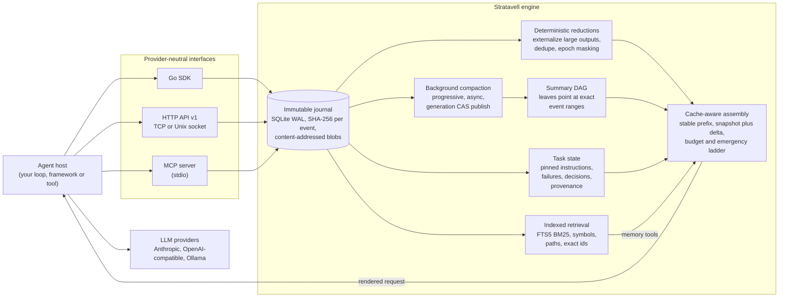

# Stratavell

**Compress context. Preserve knowledge.**

Stratavell is a provider-agnostic context management engine for long-running LLM agents, written in Go. It keeps every message, tool call and tool output in an immutable local journal. Each model request is built as a view of that journal:
- recent work verbatim
- older work as summaries and masked observations
- standing user instructions pinned
- everything else retrievable exactly, by id

Summaries are produced in the background, and the request is laid out so that prompt caches keep hitting.

It runs fully locally as a Go library, an HTTP API over TCP or a Unix socket, an MCP server and a single static executable. It needs no external database, no embedding model and no API key.

> **Research preview (v0.1.0).** The results below come from generated, fixed-trajectory workloads, reconstructed baselines and a simulated prompt-cache model. Real autonomous coding-task performance has not been evaluated yet. See [limitations](docs/limitations.md).

## Why Stratavell?

- **Conventional compaction loses information.** Rewriting the history into one summary drops exact values, early constraints and the reasons behind decisions. Repeated compaction erodes them further.
- **Long tool outputs inflate cost.** Test logs, grep results and file reads dominate agent context, and most of each one is never needed again verbatim.
- **Synchronous summarization blocks the agent.** The agent waits while the history is summarized, usually at the moment the context is fullest.
- **Badly placed compaction breaks prompt caching.** Editing early parts of the prompt invalidates the cached prefix, and every later request pays full price.
- **Every agent framework rebuilds this.** Stratavell is a standalone engine that any host can call, so the logic is written and tested once.

## Architecture



The engine never calls the primary model. The host sends the assembled request to its provider and appends the response. The model can recover anything archived through memory tools (`memory_search`, `memory_expand`, `memory_get_event` and others) that the engine executes. More in [docs/architecture.md](docs/architecture.md) and [ADR 0001](docs/adr/0001-context-engine-architecture.md).

## Performance

**Benchmark conditions**
- **Workload:** generated 300-turn coding sessions of 2.9 to 3.2 million raw tokens each, with a scripted trajectory.
- **Window:** 64k tokens. **Seeds:** 5.
- **Summarizer:** extractive, deterministic.
- **Costs:** simulated input costs at Claude Sonnet 5.5 list prices, from a model of Anthropic's documented prompt-cache rules. They are not provider bills.

The comparison below is against **component-matched** baselines: asynchronous and synchronous progressive summarization (similar to APEC), each given the same retrieval tools and automatic evidence injection that Stratavell has.

| strategy | requests that fit | simulated input cost per session | facts recoverable | standing rules visible | foreground summarization wait |
|---|---|---|---|---|---|
| async progressive summaries + retrieval | 100% | $12.88 ± 0.44 | 97.2% | 21.9% | 0 s |
| sync progressive summaries + retrieval | 100% | $11.36 ± 0.55 | 97.2% | 22.0% | 320 s |
| **Stratavell** | **100%** | **$6.43 ± 0.20** | **100%** | **100%** | **0 s** |

How to read the table:
- **Facts recoverable:** a planted fact and its supporting evidence are in the context, or are found by one fixed retrieval query.
- **Standing rules visible:** the user's earlier rules appear in the assembled context. That is visibility, not compliance.
- **The main result:** at comparable fact recoverability, Stratavell costs about half as much as retrieval-enabled asynchronous progressive summarization (50% lower).
  - In the ablations, most of the saving comes from externalizing oversized tool outputs at ingestion, from batched (epoch) masking and from the cache-aware layout.

Other results:
- **QA with a real model:** in a pre-registered question-answering run (Claude Haiku 5.5 reader, 33 questions, 1 seed), the grounded-answer counts were a tie:
  - Stratavell: 28
  - conventional compaction with a passive Stratavell archive: 27
  - async summaries with retrieval: 26
- **200k window** (400 turns, 3 seeds):
  - Stratavell's simulated input cost was $10.44 per session, against $16.46 to $27.62 for conventional, sync and async compaction without retrieval.
  - No component-matched variants were run at this size.
- **Engine latency:** the measurements below used one 8-core laptop CPU, `synchronous=FULL`, pure-Go SQLite.

  | operation | measurement |
  |---|---|
  | assembly, 45k-token context | 1.35 ms mean |
  | engine time per benchmark turn | about 3 ms p95 |
  | search, 3.4k indexed chunks | p95 9.4 ms |
  | search, 13.2k chunks | p95 33.7 ms (misses the 20 ms target) |
  | appending a small event | 0.56 ms mean (fsync on every commit) |
- **Tested window sizes:** 64k and 200k tokens.

**Real autonomous coding-task success has not been evaluated.** Instruction compliance was not measured either, only instruction visibility.

The full method is in [docs/benchmarks.md](docs/benchmarks.md):
- every table, with standard deviations
- the uncompressed, conventional, noa-style and masking-only baselines
- eleven ablations
- the cost accounting
- the external review and the changes made in response

Every run, including failed and superseded ones, is logged in [docs/experiments.md](docs/experiments.md).

## Quick start

Requires Go 1.26.11 or newer (earlier 1.26 releases have standard-library vulnerabilities that affect the HTTP server). No cgo, no C toolchain.

```bash
go install github.com/TobiasLogic/stratavell/cmd/stratavell@latest
```

Or build from a clone:

```bash
git clone https://github.com/TobiasLogic/stratavell
cd stratavell
go build -o bin/stratavell ./cmd/stratavell
```

Start a local server. It listens on `127.0.0.1:7077`; a non-loopback address requires a token.

```bash
stratavell serve --db demo.db
```

In another terminal, record a user message and a tool exchange, then assemble a request rendered for the Anthropic Messages API:

```bash
API=http://127.0.0.1:7077/v1/sessions
curl -s -X POST $API -d '{"id":"demo"}'
curl -s -X POST $API/demo/agents -d '{"id":"main"}'
curl -s -X POST $API/demo/agents/main/events -d '{"messages":[
  {"role":"user","parts":[{"type":"text","text":"Fix the failing test. Never edit vendor/."}]},
  {"role":"assistant","parts":[{"type":"tool_call","tool_call_id":"c1","tool_name":"bash","input":{"command":"go test ./..."}}]},
  {"role":"tool","parts":[{"type":"tool_result","tool_call_id":"c1","tool_name":"bash","text":"--- FAIL: TestParse\n    parse_test.go:42: expected 3, got 4\nFAIL","is_error":true}]}]}'
curl -s -X POST $API/demo/agents/main/assemble \
  -d '{"format":"anthropic","model":"claude-sonnet-5-5","max_tokens":4096,"include_memory_tools":true}'
curl -s "$API/demo/agents/main/search?q=parse_test"
curl -s $API/demo/agents/main/task-state
```

The `assemble` response holds `request`, a body ready to send to the provider, plus token counts and a report of what the engine did. Send it, report the provider's usage to `.../usage`, append the assistant's reply and any tool results, and repeat.

Every integration follows that loop; [docs/integration.md](docs/integration.md) describes it step by step.

### Go SDK

```go
e, err := engine.Open(ctx, engine.Options{Path: "memory.db", Summarizer: summarize.Extractive{}})
if err != nil {
	log.Fatal(err)
}
defer e.Close()
sess, _ := e.OpenSession(ctx, "task-42", engine.SessionConfig{})
agent, _ := sess.Agent(ctx, "main")

agent.Append(ctx, msg.Text(msg.RoleUser, "Fix the flaky test. Never edit vendor/."))
cx, err := agent.Assemble(ctx, engine.AssembleRequest{System: "You are a coding agent.", IncludeMemoryTools: true})
if err != nil {
	log.Fatal(err)
}
req, err := anthropic.Render(cx, anthropic.Options{Model: "claude-sonnet-5-5", MaxTokens: 8192})
```

`agentloop.Step` runs one full turn against a model client: assemble, call, record usage, append, execute tools. A complete runnable program is in [examples/go](examples/go/main.go).

## Integration modes

| mode | transport | what the engine controls |
|---|---|---|
| **Go SDK** | in process | the full context: compaction, masking, budget, cache layout, task state, retrieval |
| **HTTP API** | TCP (`--addr`) | the same, from any language; versioned under `/v1`, specified in [docs/openapi.yaml](docs/openapi.yaml) |
| **Unix socket** | `--socket path` (mode 0600) | the same as HTTP, for local processes, without a TCP port |
| **MCP server** | stdio (`stratavell mcp`) | **passive memory only**: archiving and retrieval tools |

The first three are **full inference-loop integration**. The host routes every model request through `assemble`, and the engine decides what the model sees, within a token budget it enforces.

**MCP alone does not replace a host's own compaction.** An MCP server cannot see or rewrite the host's context. In passive mode the model can archive material with `memory_archive` and retrieve exact originals, but the host still decides what stays in its window. Use full integration when you control the agent loop. Use MCP for hosts you cannot change.

An MCP host configuration looks like this:

```json
{
  "mcpServers": {
    "stratavell": {
      "command": "stratavell",
      "args": ["mcp", "--db", "/path/to/stratavell/memory.db", "--session", "my-project"]
    }
  }
}
```

## Provider support

| adapter | API | how it is tested |
|---|---|---|
| `adapters/anthropic` | Anthropic Messages API: tool use, `cache_control` breakpoints, thinking blocks, token counting | unit tests against the documented request shape; not yet exercised against the live API |
| `adapters/openai` | OpenAI-compatible chat completions | unit tests; used live through OpenRouter for the real-model benchmark runs |
| `adapters/ollama` | Ollama native `/api/chat` with an explicit `num_ctx` | one live local smoke call; no automated tests |

Any of them can also serve as the background summarizer. The default summarizer is extractive and calls no model.

## Examples

All four run against a local server in CI (`scripts/examples-smoke.sh`):

| example | transport |
|---|---|
| [Go](examples/go/main.go) | in-process SDK |
| [Python](examples/python/example.py) | HTTP over a Unix socket, standard library only |
| [TypeScript](examples/typescript/example.ts) | HTTP with `fetch`, Node 22 or newer |
| [Rust](examples/rust/src/main.rs) | HTTP with `ureq` |

## Documentation

| document | contents |
|---|---|
| [docs/integration.md](docs/integration.md) | the per-turn loop, full versus passive integration, provider formats, subagents, custom components |
| [docs/openapi.yaml](docs/openapi.yaml) | HTTP API reference |
| [docs/configuration.md](docs/configuration.md) | every policy field and its default |
| [docs/operations.md](docs/operations.md) | running, environment variables, inspection, deletion, backup, migration from palimpsest |
| [docs/stability.md](docs/stability.md) | which interfaces are intended to stay stable and which are experimental |
| [docs/architecture.md](docs/architecture.md) | data model, invariants, rendering, assembly, retrieval, multi-agent model |
| [docs/schema.md](docs/schema.md) | storage schema and integrity checks |
| [docs/benchmarks.md](docs/benchmarks.md) | benchmark method and every result table |
| [docs/limitations.md](docs/limitations.md) | **known limitations** |
| [docs/roadmap.md](docs/roadmap.md) | planned work and the next evaluation phase |

## Research

Stratavell builds on published work and open-source code; [docs/research/](docs/research/README.md) records what was taken from each and what was not:
- **APEC** and CompactionBench (Liu et al., Microsoft): progressive, asynchronous compaction published at request boundaries.
- **LCM** (Ehrlich and Blackman) and the **Volt** source: an immutable store, a summary DAG and exact expansion.
- **The Complexity Trap** (Lindenbauer et al., JetBrains Research): observation masking as a strong, cheap first tier.
- **Benchmarks Are Surprisingly Compaction-Friendly** (Salle, Bhatnagar et al.): constraint erosion across repeated compaction.
- **Context Mode:** content-aware handling and indexing of large tool outputs.
- **Contextual Memory Virtualisation** (Santoni): lossless trimming of tool output.
- **Norma and its noa engine:** the tiered compression design reimplemented as a baseline.
- Anthropic's prompt caching, context editing and extended thinking documentation.

No third-party code or prompts were copied.

## Limitations

Read [docs/limitations.md](docs/limitations.md) before relying on the numbers. In short:
- the workloads are generated, and I designed both them and the engine
- the baselines are reconstructions, not the original systems
- costs are simulated
- samples are small
- lexical search p95 is 33.7 ms at 13k indexed chunks, above the 20 ms target
- the API may change before 1.0

## Roadmap

- **Independent benchmarks:** LOCA-bench, OOLONG, an executable coding benchmark such as SWE-bench Pro, and CompactionBench if it is released.
- **Stronger baselines:** model-written summaries for the conventional baseline, and direct comparisons with the original implementations.
- **Real agent trajectories,** with actual provider billing and cache usage, cross-provider validation, confidence intervals and cost per completed task.
- **Real-world integrations,** and concurrency testing beyond four agents.

Details are in [docs/roadmap.md](docs/roadmap.md).

## License and contributing

Apache License 2.0. See [LICENSE](LICENSE), [NOTICE](NOTICE) and [THIRD_PARTY_NOTICES.md](THIRD_PARTY_NOTICES.md). Contributions are welcome; see [CONTRIBUTING.md](CONTRIBUTING.md). Report vulnerabilities privately as described in [SECURITY.md](SECURITY.md). Changes are listed in [CHANGELOG.md](CHANGELOG.md).
